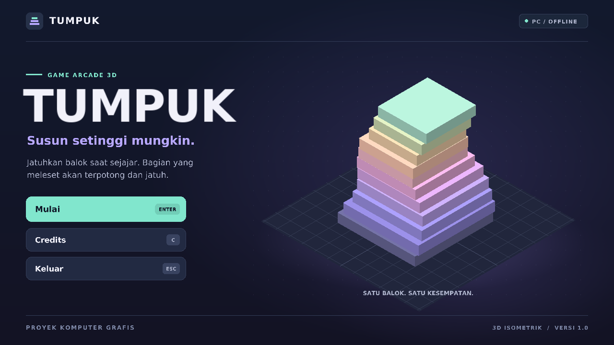

# TUMPUK

TUMPUK adalah game arcade PC 3D isometrik. Jatuhkan balok saat sejajar dengan balok di bawahnya. Bagian yang meleset terpotong dan jatuh; bagian yang tersisa menjadi dasar balok berikutnya. Run berakhir jika tidak ada bagian yang bertumpuk. Mekanik terinspirasi dari Stack (Ketchapp); judul, kode, geometri, dan antarmuka TUMPUK dibuat untuk proyek ini.



## Jalankan di Windows

ZIP ini memuat source code dan proyek build. Untuk membuat executable pertama kali diperlukan Visual Studio 2022 dengan workload **Desktop development with C++** (MSVC x64 dan Windows SDK).

1. Ekstrak seluruh ZIP ke satu folder.
2. Klik dua kali `Build-Windows.bat`.
3. Setelah muncul pesan berhasil, buka `dist\Tumpuk\Tumpuk.exe`.

Alternatif: buka `Tumpuk.sln` di Visual Studio 2022, pilih **Release** dan **x64**, lalu **Build > Build Solution**. Jalankan `dist\Release\Tumpuk.exe` atau tekan **Ctrl+F5**.

Untuk mengumpulkan build Windows, sertakan `Tumpuk.exe`, `credits.txt`, dan `LICENSE-fonts.txt` dari folder hasil build. Setelah dikompilasi, build Windows utama hanya memakai komponen OpenGL dan sistem bawaan Windows. PC pemain tidak memerlukan Visual Studio, internet, GLEW, atau DLL freeglut.

## Credits kelompok

Edit **`credits.txt` yang satu folder dengan executable**. Satu baris per anggota, dengan format `Nama lengkap | NIM`. Saat ini Affan sudah tercantum; tambahkan seluruh anggota sebelum mengumpulkan. Menu **Credits** dapat dibuka dari menu utama atau tombol **C**. File dibaca ulang setiap kali Credits dibuka. Jika build baru, file dari folder proyek akan disalin; build ulang tidak menimpa file Credits yang sudah ada di folder hasil.

## Cara main

| Input | Aksi |
|---|---|
| Enter atau klik **Mulai** | Memulai run |
| Space atau klik area arena | Menjatuhkan balok |
| P, Esc, atau klik **Jeda** | Menjeda permainan |
| Enter saat dijeda | Melanjutkan |
| R atau klik **Coba lagi** | Mengulang setelah run selesai |
| C dari menu utama | Membuka Credits |

Balok bergerak bergantian pada sumbu X dan Z. Jika penempatan cukup dekat dengan pusat, balok terkunci pas dan ukurannya tidak berkurang. Beberapa penempatan pas berturut-turut membentuk combo. Kecepatan bertambah seiring skor. Rekor disimpan lokal di `%LOCALAPPDATA%\Tumpuk\score.txt`.

## Pemetaan ketentuan tugas

| Ketentuan | Implementasi |
|---|---|
| Interactive computer graphics | Keyboard dan mouse mengubah keadaan permainan serta tampilan balok secara langsung. |
| Tujuan | Permainan arcade yang menguji ketepatan waktu. |
| Tampilan | Balok 3D, proyeksi ortografik dengan sudut isometrik, serta antarmuka 2D. |
| Platform | PC. Build utama memakai C++17 dan OpenGL Win32. Ada backend freeglut opsional. |
| Credits | Menu Credits menampilkan nama dan NIM dari file lokal. |
| Standalone dan offline | Semua balok, grid, dan UI digambar dari kode. Font tertanam. Rekor dan Credits memakai file lokal. |

## Teknik grafis dan logika

- **Geometri 3D:** setiap balok digambar sebagai enam bidang. Warna bidang atas dan sisi dibedakan agar kedalamannya terlihat.
- **Proyeksi:** sudut kamera tetap dan proyeksi ortografik menjaga skala balok. Kamera mengikuti menara; antarmuka tetap dalam koordinat layar.
- **Pemotongan:** ambil irisan interval balok aktif dan balok pendukung pada sumbu gerak. Panjang irisan menjadi ukuran baru. Selisihnya menjadi potongan yang diberi animasi jatuh dan rotasi.
- **Waktu dan input:** pergerakan, animasi, dan respons kontrol dihitung terpisah dari fungsi gambar. Saat jendela diubah ukurannya, rasio 16:9 dan koordinat mouse tetap sesuai.
- **Berkas:** `src/game.hpp` untuk aturan permainan; `src/app.cpp` untuk render dan layar; `src/main_win32.cpp` dan `src/main_freeglut.cpp` untuk jendela dan input.

## Backend freeglut (opsional)

Jika ingin memakai freeglut untuk demonstrasi kelas, siapkan CMake, compiler C++17, dan paket pengembangan OpenGL/freeglut. Dari folder proyek:

```text
cmake -S . -B build-glut -DTUMPUK_FREEGLUT=ON
cmake --build build-glut --config Release
```

Jika freeglut dipasang melalui vcpkg, tambahkan `-DCMAKE_TOOLCHAIN_FILE=path/ke/vcpkg.cmake` pada perintah konfigurasi. Bila freeglut ditautkan dinamis, sertakan DLL yang cocok dengan arsitektur executable. Untuk pengumpulan di Windows, jalur `Build-Windows.bat` di atas lebih sederhana karena tidak memerlukan DLL tersebut.

## Pemeriksaan

Logika dan render bersama sudah diuji di Linux dengan Mesa OpenGL: penempatan pas, combo, pemotongan X/Z, run selesai, jeda, retry, input mouse setelah resize, Credits, dan rekor setelah app dibuka ulang. Screenshot ada di `preview/`. Build Windows belum dijalankan di lingkungan pengujian ini. Jalankan build di PC Windows, lalu cek menu Credits dan coba satu run sebelum mengumpulkan.
